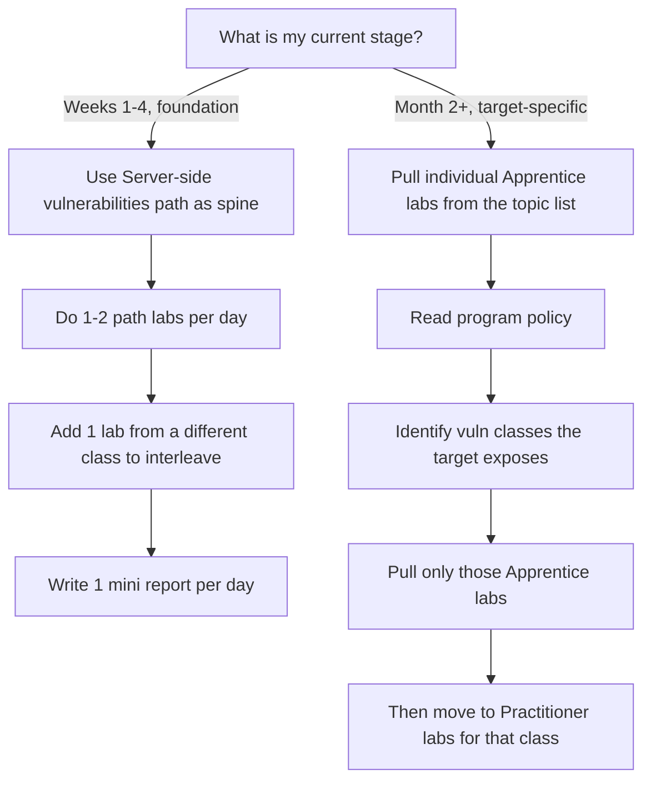

---------------

created: 2026-11-05
-------------------------------------------


# 🧭 PortSwigger Learning OS — Path, Labs & SQLi Decision

> [!abstract] The Whole Decision in One Place
> You finished the SQLi Apprentice labs. Now what?
>
> **Do not finish all SQLi labs today. Do not start the SQL injection learning path.**
> **Open the “Server-side vulnerabilities” path — the only Apprentice-rated path — and let it interleave for you.**
>
> This note combines two decisions into one operating system:
> 1. Why finishing all SQLi labs today is a trap.
> 2. Why the Server-side vulnerabilities path is your spine, not the all-labs list.

---

## 🚨 The Two Rules That Govern Today

> [!danger] Rule 1 — Stop Overlearning SQLi
> **Do not open another SQLi lab today.**
> Finishing one entire vulnerability class in a single session is exactly the pattern the Learning OS is designed to prevent.

> [!danger] Rule 2 — Follow the Only Apprentice Path
> **17 learning paths are listed on PortSwigger. Exactly ONE is rated APPRENTICE.**
> The other 16 — including **SQL injection** — are rated PRACTITIONER.
> That is PortSwigger telling you: *“A beginner should not be walking these paths yet.”*

---

## 🧠 Why Finishing All SQLi Labs Today Is a Trap

> [!warning] Three Principles You Would Violate
> - **Overlearning** → repeating the same easy technique in one session wastes time.
> - **Einstellung** → your brain locks into “SQLi mode” and stops seeing other vulnerability patterns.
> - **Illusion of competence** → finishing 10 labs feels like mastery, but you may only recognize *SQLi-shaped* inputs, not *when SQLi is the wrong tool*.

> [!quote] From the Learning OS
> *“Never spend an entire study block firing `<script>alert(1)</script>` at every input. When an HTML tag payload fails, shift out of Einstellung by checking if your input lands inside an existing `<script>` tag, an HTML attribute, a JSON file upload, or a template engine. Mix multiple vulnerability classes every week.”*

The same logic applies to SQLi:
**If you only do SQLi today, tomorrow your brain will try to SQLi everything.**

---

## ✅ Why the Server-Side Vulnerabilities Path Wins

> [!success] Your Answer
> Follow the **Server-side vulnerabilities** path.
> It is the **only Apprentice-rated path** on the page, and the **only one that matches your Learning OS Week 1–4 plan**.
>
> Do **not** start the SQL injection path today.
> Do **not** start any of the 16 Practitioner paths yet.

> [!info] What “Server-side vulnerabilities” gives you
> - A **cross-topic overview**: SQLi, access control, authentication, path traversal, OS command injection, business logic, SSRF, XXE, file upload — mixed, not ground one-by-one.
> - **Built-in interleaving**: the path itself alternates vulnerability classes, which is exactly what your Learning OS prescribes to defeat *Einstellung*.
> - **Apprentice-level ceiling**: the labs inside are beginner-rated, so your 20-minute rule stays meaningful. You will hit “stuck” states that are solvable, not hopeless.

> [!warning] Why every other path is a trap right now
> - **SQL injection path** → Practitioner-rated. You already did the Apprentice labs. Starting the path now = overlearning + a wall of Practitioner labs you are not ready for.
> - **SSRF / XXE / SSTI / Race conditions / Auth / CORS / GraphQL / NoSQL / Prototype pollution / WebSockets / Web cache deception / Clickjacking / Path traversal / File upload / API testing / Web LLM** → all Practitioner. These are **Weeks 3–4 and Month 2** material, not today.
> - **CSRF path** → Practitioner-rated even though CSRF is a beginner-friendly class. Do the individual **Apprentice CSRF labs**, not the full path.

---

## 🌳 Decision Tree



> [!abstract] The Rule
> **Paths are for building breadth. Topics are for building depth on demand.**
> Do not confuse the library catalog with the reading list.

---

## 📅 Path vs. All Labs Order

| Situation | Use | Why |
|---|---|---|
| Week 1–4, building foundation | **Server-side vulnerabilities path** | Apprentice-rated, interleaved, matches your plan |
| You want to hit a specific class harder | **Individual Apprentice labs** from that topic | Avoids the Practitioner wall |
| Month 2+, target has a specific tech stack | **Topic-specific Practitioner path** | Now you have context to absorb it |
| You just finished a class | **Switch to a different class, not the same path** | Defeats overlearning and Einstellung |
| You feel stuck in one class for too long | **A different topic** — one Apprentice lab | Breaks Einstellung |
| You are tempted to “finish all SQLi labs” | **Stop. Switch class.** | Overlearning ≠ mastery |

> [!important] Path vs. Menu
> The learning path is a **schedule**. The all-labs list is a **menu**.
> You need a schedule right now.

---

## 🎯 Path → Your 4-Week Plan

| Week | Path or Labs | Focus |
|---|---|---|
| **Week 1 (today – Day 7)** | **Server-side vulnerabilities path** — 1–2 labs per day | Broad overview + interleaving |
| **Week 2** | Finish remaining Apprentice labs in the path + **individual Access Control Apprentice labs** | IDOR + auth basics |
| **Week 3** | **SSRF, XXE, SSTI paths** — Apprentice labs only | Server-side parsers |
| **Week 4** | **OS command injection, Race conditions, Authentication paths** — Apprentice labs only | Execution + concurrency + auth |
| **Month 2+** | Any **Practitioner path** matching your chosen program's scope | Depth + real targets |

---

## 🚫 What to Skip Today (Explicit List)

> [!failure] Do Not Open These Paths Yet
> - ❌ SQL injection path *(Practitioner — you already did the Apprentice labs)*
> - ❌ CSRF path *(Practitioner — do individual Apprentice labs instead)*
> - ❌ SSRF path *(Practitioner — Week 3)*
> - ❌ XXE / SSTI / File upload / Path traversal / Race conditions / Auth / CORS / GraphQL / NoSQL / Prototype pollution / WebSockets / Web cache deception / Clickjacking / API testing / Web LLM *(all Practitioner — Weeks 3–4 and Month 2)*

> [!note] Why the SQLi Path Is Rated Practitioner
> The path includes **blind SQLi, time-based SQLi, second-order SQLi, and out-of-band SQLi**. Those are not Week 1 material. If you finished “all SQLi labs” in a day, you almost certainly finished the **Apprentice** ones — and the Practitioner labs inside the path will stop you cold. That is the wall the rating is warning you about.

---

## ✅ Salvage Protocol — 90 Minutes

> [!success] Consolidate + Interleave
> You are not undoing work. You are consolidating it and moving sideways.

### Step 1 — Stop Adding New SQLi Labs (5 min)
- [ ] Close the SQLi lab list.
- [ ] Do **not** open another SQLi Apprentice lab today.
- [ ] Write one sentence: “I stopped because overlearning creates Einstellung.”

### Step 2 — Active Recall From Memory (15 min)
Close every tab. On a blank page, write:

- [ ] The **trigger question** for SQLi:
  > *“Does a single quote, comment, boolean condition, or time delay change the server’s response or timing?”*
- [ ] The **three SQLi test moves** from the book:
  1. `'` and `'--` / `#` comment truncation
  2. Boolean inference: `AND 1=1--` vs. `AND 1=2--`
  3. Time delay: `sleep(12)=1` or equivalent
- [ ] One sentence on **why** a prepared statement with an **array key injection** can still be vulnerable.

> [!question] Pass Test
> Can you explain, without notes, the difference between **in-band**, **blind boolean**, and **time-based blind** SQLi?

### Step 3 — Write One Mini Report (20 min)
Pick **one** SQLi lab you solved today. Write a Ch 20-style mini report:

```markdown
## Mini Report — SQLi Lab

**Title:** [Vulnerability Type] on [Endpoint] via [Parameter] allows [Impact]

**Policy & Scope Check:** Lab environment / authorized target.

**Vulnerability Description & Root Cause:**
The endpoint [URL] accepts user-controlled input in [parameter] and passes it
unsanitized into [query context], allowing an attacker to [mechanism].

**Steps to Reproduce:**
1. Authenticate / open [URL].
2. Intercept the request in Burp and modify [parameter] to:
   [payload]
3. Observe [exact evidence: hidden data returned / login bypassed / timing delay].

**Security Impact:**
An attacker can [read unauthorized data / bypass authentication / infer database contents],
affecting [scope].
```

- [ ] Save it in `03 Reports/`.
- [ ] This report is now your **reference chunk** for SQLi.

### Step 4 — Interleave One Different Class (25 min)
Do **one** Apprentice lab from the **Server-side vulnerabilities path** that looks *most unlike SQLi*:

- [ ] Access control / IDOR, **or**
- [ ] Path traversal, **or**
- [ ] Authentication

> [!tip] Why This Matters
> Your brain needs to practice **switching context**.
> The moment you move from SQLi to access control, you are training the exact skill a real bug hunter needs: *“What kind of bug is this parameter likely to have?”*
> Try for 20 minutes. Read **one hint** only if stuck. Close hint. Re-do.

> [!success] Today’s Revised Success Criteria
> - [ ] You can state the SQLi trigger question from memory.
> - [ ] You wrote **one** SQLi mini report.
> - [ ] You opened the **Server-side vulnerabilities path**.
> - [ ] You completed **one** lab from a different vulnerability class.
> - [ ] You did **not** start the SQL injection path.
> - [ ] You did **not** open any Practitioner path.
> - [ ] You did **not** open another SQLi lab after this decision.

---

## 📅 Adjusted Plan for Today

| Block | Original Plan | Adjusted Plan |
|---|---|---|
| Block 1 | Web runtime recall | ✅ Keep — but add SQLi trigger question to flashcards |
| Block 2 | 1 SQLi lab | 🔁 Replace with **SQLi active recall + 1 mini report** |
| Block 3 | Policy + flashcards | ✅ Keep — add **1 different-class lab** from the Server-side path |
| Evening | 3 flashcards + 6 tasks | ✅ Keep — add “Do not overlearn one class” as a rule |

---

## 🧭 Rules for the Rest of Week 1

> [!important] The Interleaving Contract
> **Maximum 2 labs from the same vulnerability class per day.**
> After that, switch classes — even if you feel “on a roll.”
> The feeling of being on a roll is often **Einstellung wearing a confidence costume**.

> [!important] When to Graduate From Paths
> - **Before Month 2** → paths are your map. Follow them.
> - **After Month 2** → paths become a library. Pull the class you need for your target, ignore the rest.
> - **Never** → finish an entire Practitioner path just to “complete” it. That is gamification, not learning.

> [!quote] Keep This on Your Dashboard
> *“A hunter who only knows SQLi sees every parameter as a query. A hunter who interleaves sees the parameter for what it is.”*

> [!quote] Keep This on Your Dashboard Too
> *“The path is not the goal. The path is the interleaving schedule. The lab is the goal.”*

---

## 📋 Obsidian Checklist (Copy-Paste to Daily Note)

```markdown
## Day ___ — Path Work
### Path
- [ ] Opened: Server-side vulnerabilities
- [ ] Lab done: ______________________ (topic: __________)
- [ ] Stuck-for-20-then-hint used? Y / N

### Interleave
- [ ] Second lab from a different class: ______________________

### Output
- [ ] Mini report written: ______________________
- [ ] Flashcard added: ______________________

### Do-Not-Touch Today
- [ ] Did NOT open the SQL injection path
- [ ] Did NOT open any Practitioner path
- [ ] Did NOT grind the same class all day
```

---

## 🔁 One-Line Summary

> [!abstract] Answer
> **Finishing all SQLi labs today is not “10x faster” — it is 1x speed with a blind spot.**
> **Follow the “Server-side vulnerabilities” path — it is the only Apprentice-rated path, and it is the only one your Learning OS plan supports right now.**
> Stop. Recall from memory. Write one report. Do one lab from a different class. Let the path do the interleaving for you. That is the 10x move.

---

## 🖼️ Reference

![[./attachments/Pasted image 20261105125624.png|Pasted image 20261105125624.png]]

