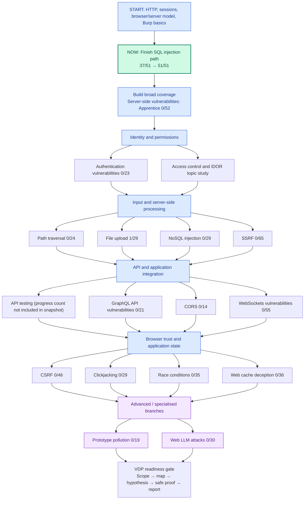

# 🔐 Cybersecurity Journal — PortSwigger Web Security Academy

> **Understand the application. Form a hypothesis. Test it carefully. Explain the evidence.**

This repository is my practical journey into web application security, Burp Suite, and eventually my first valid Vulnerability Disclosure Program (VDP) report.

I'm not here just to collect completed labs or memorise payloads. I want to understand how web applications work, how security boundaries fail, how to investigate those failures, and how to explain what the evidence proves. I'm also building a better way to learn: fewer distractions, deeper understanding, deliberate practice, and notes I can return to without having to figure out my direction all over again.

**This is a learning dashboard, not a claim of expertise.** The progress below is the snapshot I recorded from my PortSwigger dashboard. It does not update automatically; I will update it as I work.

---

## 🧭 Quick Navigation

- [Current focus](#-where-i-am-right-now)
- [Visual roadmap / mind map](#️-visual-roadmap--mind-map)
- [Recommended order](#-the-order-i-will-follow)
- [All my learning paths and progress](#-all-learning-paths--my-progress)
- [My testing methodology](#-the-method-i-will-use-for-every-lab)
- [Lab-note template](#-lab-note-template)
- [Focus routine](#-focus-routine)
- [Journey to my first VDP report](#-journey-to-my-first-vdp-report)
- [Definition of done](#-definition-of-done)

## 📍 Where I Am Right Now

> **Current sprint:** Finish the SQL injection learning path.
>
> **PortSwigger progress snapshot:** SQL injection **37/51** · File upload **1/29** · Server-side vulnerabilities (Apprentice) **0/52**.
>
> **Immediate next action:** Continue the SQL injection path from the Academy's **Resume** button. Work through the remaining content deliberately, then revisit the hardest concepts without following the solution.

### This session's checklist

- [ ] Open the [SQL injection learning path](https://portswigger.net/web-security/learning-paths/sql-injection) and resume where I stopped.
- [ ] Read the lab objective and identify the application behaviour I need to understand.
- [ ] Capture the baseline request and response in Burp Suite.
- [ ] Write one hypothesis before testing payload variations.
- [ ] Change one variable at a time and record what the response tells me.
- [ ] Explain the root cause and a relevant defence in my own words.
- [ ] Update my progress and write the next action before ending the session.

**Rule:** I do not start three new topics because one lab gets difficult. I record the obstacle, try a smaller experiment, and return to the same question.

<details>
<summary><strong>Session hand-off note — fill this in before stopping</strong></summary>

- **Date:** YYYY-MM-DD
- **Current path / lab:**
- **What I understand now:**
- **What I tested:**
- **Evidence / result:**
- **What still confuses me:**
- **Next exact action:**

</details>

---

## 🗺️ Visual Roadmap / Mind Map

This map shows how the topics connect and which direction to take. The path is deliberately not “complete every Academy item before doing anything real.” Build fundamentals, practise a repeatable method, then start low-risk, authorised VDP research when ready. Advanced branches can be revisited over time.



### How to read the map

- **Start with the current sprint:** continue SQL injection because meaningful progress is already recorded.
- **Then build breadth:** use the Apprentice server-side path to connect different server-side vulnerability classes.
- **Prioritise identity and access:** authentication and object/function-level authorisation are central to understanding real applications.
- **Follow the data:** path traversal, file uploads, NoSQL injection, and SSRF teach how user-controlled data reaches sensitive operations.
- **Learn the seams:** APIs, GraphQL, CORS, WebSockets, CSRF, and clickjacking show how components and browser security boundaries interact.
- **Leave specialised topics for later:** race conditions, cache deception, prototype pollution, and LLM attacks are worth studying, but they do not all need to come before your first careful VDP attempt.

The map is a **recommended route, not a rigid prerequisite graph**. If a lab exposes a gap in HTTP, JavaScript, cookies, or application logic, pause and fill that gap.

---

## 🧭 The Order I Will Follow

| Step | Focus | Why here? | Completion evidence |
|---:|---|---|---|
| **0** | HTTP, sessions, Burp Proxy/HTTP history/Repeater, mapping | Gives every later lab a shared mental model | I can explain a user action from browser to server and back. |
| **1 — CURRENT** | Finish SQL injection **37/51 → 51/51** | Finish the path already in progress instead of repeatedly switching topics | I can explain the remaining concepts, reproduce key reasoning without a walkthrough, and describe relevant fixes. |
| **2** | Server-side vulnerabilities — Apprentice **0/52** | Broad, beginner-oriented coverage of common server-side weaknesses | I can classify the vulnerable component and explain how input reaches it. |
| **3** | Authentication + access control | High-value skills for reasoning about identity, roles, sessions, and ownership | I can test permissions in a controlled lab using accounts and objects I am authorised to access. |
| **4** | Path traversal, file upload, NoSQL injection, SSRF | Builds data-flow thinking across files, queries, and server-side requests | I can trace input to the sensitive operation, prove the behaviour safely, and explain the root cause. |
| **5** | API testing, GraphQL, CORS, WebSockets | Expands testing beyond visible web pages into API and protocol behaviour | I can map endpoints and reason about auth, trust boundaries, and cross-origin behaviour. |
| **6** | CSRF, clickjacking, race conditions, cache deception | Covers browser trust and unexpected application state | I can describe the prerequisite, intended rule, observed failure, and impact. |
| **7** | Prototype pollution and Web LLM attacks | Specialised topics that benefit from a solid foundation | I can explain the relevant runtime or LLM trust boundary and demonstrate a lab scenario. |
| **8** | VDP practice | Convert lab skills into safe, scoped testing and clear reporting | I can follow a program policy and write a reproducible report with evidence. |

**Important:** You do not need to finish every learning path before beginning VDP research. Once the foundations, scope discipline, mapping method, and safe proof standards are reliable, you can start mapping one explicitly authorised program while continuing to learn.

---

## 📚 All Learning Paths & My Progress

The progress values below are copied from the dashboard text I supplied. They are a **snapshot**, not a live GitHub integration. Update the count and status after working in PortSwigger. The number is labelled as Academy progress; do not assume each unit corresponds to one independently solved lab.

| Recommended order | Learning path | Academy progress snapshot | Priority | Link |
|---:|---|---:|---|---|
| 1 | **SQL injection** | **37/51** | 🟢 Finish current path | [Resume SQL injection](https://portswigger.net/web-security/learning-paths/sql-injection) |
| 2 | **Server-side vulnerabilities — Apprentice** | **0/52** | 🔵 Broad foundations | [Open learning path](https://portswigger.net/web-security/learning-paths/server-side-vulnerabilities-apprentice) |
| 3 | **Authentication vulnerabilities** | **0/23** | 🔴 Core VDP skill | [Open learning path](https://portswigger.net/web-security/learning-paths/authentication-vulnerabilities) |
| 4 | **Path traversal** | **0/24** | 🔴 Core server-side skill | [Open learning path](https://portswigger.net/web-security/learning-paths/path-traversal) |
| 5 | **File upload vulnerabilities** | **1/29** | 🔴 Core server-side skill | [Open learning path](https://portswigger.net/web-security/learning-paths/file-upload-vulnerabilities) |
| 6 | **NoSQL injection** | **0/29** | 🟠 Server-side input handling | [Open learning path](https://portswigger.net/web-security/learning-paths/nosql-injection) |
| 7 | **Server-side request forgery (SSRF)** | **0/65** | 🟠 Server-side trust boundaries | [Open learning path](https://portswigger.net/web-security/learning-paths/ssrf-attacks) |
| 8 | **API testing** | Not visible in supplied snapshot | 🟠 After current sprint | [Resume API testing](https://portswigger.net/web-security/learning-paths/api-testing) |
| 9 | **GraphQL API vulnerabilities** | **0/21** | 🟠 API branch | [Open learning path](https://portswigger.net/web-security/learning-paths/graphql-api-vulnerabilities) |
| 10 | **Cross-origin resource sharing (CORS)** | **0/14** | 🟠 Browser/API boundary | [Open learning path](https://portswigger.net/web-security/learning-paths/cors) |
| 11 | **WebSockets vulnerabilities** | **0/55** | 🟠 Protocol-specific testing | [Open learning path](https://portswigger.net/web-security/learning-paths/websockets-security-vulnerabilities) |
| 12 | **Cross-site request forgery (CSRF)** | **0/46** | 🟠 Browser trust | [Open learning path](https://portswigger.net/web-security/learning-paths/csrf) |
| 13 | **Clickjacking (UI redressing)** | **0/29** | 🟠 Browser trust | [Open learning path](https://portswigger.net/web-security/learning-paths/clickjacking) |
| 14 | **Race conditions** | **0/35** | 🟣 Advanced state handling | [Open learning path](https://portswigger.net/web-security/learning-paths/race-conditions) |
| 15 | **Web cache deception** | **0/36** | 🟣 Advanced request/cache behaviour | [Open learning path](https://portswigger.net/web-security/learning-paths/web-cache-deception) |
| 16 | **Prototype pollution** | **0/19** | 🟣 Advanced JavaScript/runtime behaviour | [Open learning path](https://portswigger.net/web-security/learning-paths/prototype-pollution) |
| 17 | **Web LLM attacks** | **0/30** | 🟣 Specialised / later | [Open learning path](https://portswigger.net/web-security/learning-paths/llm-attacks) |

### Useful topic pages alongside the learning paths

Some important topics are available as topic pages rather than separate cards in the progress snapshot above. Add these to the roadmap when useful:

- [Access control](https://portswigger.net/web-security/access-control) — object ownership, roles, and authorisation checks.
- [Business logic vulnerabilities](https://portswigger.net/web-security/logic-flaws) — workflows, assumptions, and state transitions.
- [Cross-site scripting (XSS)](https://portswigger.net/web-security/cross-site-scripting) — browser-side execution and output context.
- [XML external entity (XXE) injection](https://portswigger.net/web-security/xxe) — unsafe XML parser behaviour.
- [HTTP request smuggling](https://portswigger.net/web-security/request-smuggling) — disagreement between HTTP-processing components.
- [OWASP Web Security Testing Guide](https://owasp.org/www-project-web-security-testing-guide/) — a broader testing reference.

---

## 🧪 The Method I Will Use for Every Lab

```text
UNDERSTAND THE FEATURE
        ↓
MAP REQUESTS, ROLES, INPUTS AND STATE
        ↓
WRITE ONE SECURITY HYPOTHESIS
        ↓
CAPTURE A NORMAL BASELINE
        ↓
CHANGE ONE VARIABLE
        ↓
COMPARE REQUESTS AND RESPONSES
        ↓
VERIFY THE BEHAVIOUR SAFELY
        ↓
EXPLAIN ROOT CAUSE, IMPACT AND DEFENCE
        ↓
DOCUMENT IT AND RECALL FROM MEMORY
```

### Questions I ask about each feature

| Lens | Questions |
|---|---|
| **Identity** | Who does the application believe is making this request? |
| **Authority** | What should this user be allowed to read or change? Which server-side control enforces it? |
| **Input** | Which values can I influence, and where do they go? |
| **State** | What changes after the action? Does order or repetition matter? |
| **Data flow** | Does the input reach a query, HTML output, file operation, internal request, or another interpreter? |
| **Trust boundary** | Is one component relying on another to enforce a rule? |
| **Evidence** | What did I observe directly, and what am I assuming? |
| **Impact** | What security consequence is actually demonstrated? What remains unproven? |

### Hypothesis format

> **I suspect** `[feature / endpoint]` may violate `[security rule]` because `[specific observation]`. I will compare `[baseline]` with `[one controlled change]`. If I observe `[expected evidence]`, that supports the hypothesis; otherwise, I will revise or reject it.

### Burp workflow reminders

1. **Proxy / HTTP history:** observe the normal application before experimenting.
2. **Target / site map:** build an inventory of the paths and functionality I have actually observed.
3. **Repeater:** test a small, deliberate change and compare responses.
4. **Decoder / Inspector:** understand encoding, parameters, and request structure when relevant.
5. **Notes:** save the meaningful baseline, hypothesis, test, result, and conclusion—not every click.

---

## 📝 Lab-Note Template

Create one Markdown note for each lab or concept worth remembering. The aim is to save the *reasoning*, not only the successful payload.

```markdown
# [Lab name] — [Vulnerability class]

## 1. Goal and normal behaviour
- What feature am I testing?
- What should normally happen?

## 2. Mental model
- Browser → request → server → data/service → response
- Where does my input go?
- Which component must enforce the security rule?

## 3. Attack surface
- Endpoint and method:
- User-controlled inputs:
- Relevant session/cookies:
- Roles and preconditions:

## 4. Hypothesis
- Expected security rule:
- Potential broken assumption:
- Evidence that would support or reject my idea:

## 5. Experiments
| Test | One change | Observation | Conclusion |
|---|---|---|---|

## 6. Root cause
- What precisely went wrong?
- Why did the existing control fail?

## 7. Impact and limits
- What can I demonstrate?
- Under which conditions?
- What remains unproven?

## 8. Mitigation
- What should the application enforce?
- How would I verify the fix?

## 9. Recall test
- Can I explain it without notes?
- Can I recognise the pattern in a different context?
- Which concept connects to this one?

## 10. Next action
- One small, specific task for next session:
```

### Suggested repository structure

```text
.
├── README.md                 # Roadmap, progress snapshot, and current focus
├── labs/                     # Individual Academy lab write-ups
├── concepts/                 # Mental models and cross-topic notes
├── methodology/              # Repeatable workflows and checklists
└── scripts/                  # Small, reviewed learning helpers
```

Create folders only when they are useful. Link to real notes as they are added; never list planned files as if they already exist.

---

## 🧠 Focus Routine

My goal is to make focused work repeatable, not to create a perfect timetable that breaks after one difficult day.

- **35 minutes — investigate:** one topic, one lab, one main question.
- **10 minutes — explain:** write down the baseline, hypothesis, experiment, result, and lesson.
- **5 minutes — recall:** close the notes and explain what happened, why it happened, and how it could be prevented.

If 35 minutes feels too hard on a particular day, start with 10 focused minutes and one small task. Keep unrelated tabs and notifications out of the session. Consistency matters more than forcing a long session.

### Session checklist

- [ ] I chose one concrete task before starting.
- [ ] I stayed with the task instead of switching learning sources every few minutes.
- [ ] I tested or explained something, rather than only consuming content.
- [ ] I recorded one useful observation.
- [ ] I wrote the next action before stopping.

---

## 🎯 Journey to My First VDP Report

A Vulnerability Disclosure Program does not automatically mean a paid bounty. Read the policy for the specific program and confirm exactly what is authorised before testing.

### Readiness gate

- [ ] I can use Burp to map a feature and save the relevant baseline request/response.
- [ ] I can form a testable hypothesis and change one variable at a time.
- [ ] I can distinguish authentication from authorisation and explain basic trust boundaries.
- [ ] I understand the chosen program's scope, exclusions, rate limits, and reporting process.
- [ ] I know how to stop once enough safe proof has been collected.

### Before testing a real target

- [ ] Read the program policy and verify the exact asset is in scope.
- [ ] Record prohibited activity, rate limits, account requirements, and disclosure terms.
- [ ] Use only accounts and data I am authorised to access.
- [ ] Avoid destructive actions, denial of service, persistence, social engineering, and unnecessary access to sensitive data.
- [ ] Stop after obtaining sufficient safe evidence; follow program instructions if sensitive information appears.

### Report-writing checklist

- [ ] **Title:** affected feature and specific security failure.
- [ ] **Summary:** what is broken and why it matters.
- [ ] **Affected asset:** exact in-scope host and endpoint.
- [ ] **Preconditions:** required role, account, or state.
- [ ] **Reproduction steps:** minimal, numbered, and repeatable.
- [ ] **Expected versus actual:** the intended rule and observed behaviour.
- [ ] **Evidence:** sanitised requests/responses and screenshots when useful.
- [ ] **Impact:** what was demonstrated, without speculation.
- [ ] **Remediation idea:** the control or design that should change.
- [ ] **Policy check:** submission and disclosure rules followed.

### First-report tracker

| Item | Status |
|---|---|
| Program selected | ⬜ Not started |
| Policy and scope reviewed | ⬜ Not started |
| In-scope feature mapped | ⬜ Not started |
| Hypothesis tested | ⬜ Not started |
| Finding safely reproduced | ⬜ Not started |
| Report drafted | ⬜ Not started |
| Report submitted | ⬜ Not started |
| Outcome and lesson documented | ⬜ Not started |

My first report may be duplicate, out of scope, informative, or not accepted. Each outcome is information to learn from. The objective is to develop reliable investigation and reporting skills—not to promise myself a finding by a deadline.

---

## ✅ Definition of Done

A lab is not truly learned just because the Academy marks it solved. I should be able to:

- Explain the feature's normal behaviour and the security rule involved.
- Describe the relevant requests, responses, state, and trust boundary.
- Reconstruct the test without blindly copying a walkthrough.
- Explain the root cause and a realistic mitigation.
- State exactly what the evidence proves and what it does not prove.
- Connect the concept to at least one related topic.

## 🔗 Core Resources

- [PortSwigger Web Security Academy — Learning Paths](https://portswigger.net/web-security/learning-paths)
- [Burp Suite testing workflow](https://portswigger.net/burp/documentation/desktop/testing-workflow)
- [OWASP Web Security Testing Guide](https://owasp.org/www-project-web-security-testing-guide/)
- [OWASP Top 10](https://owasp.org/www-project-top-ten/)

---

## A Final Reminder

**The mission is not to rush through labs. It is to become better at observing, reasoning, testing, and explaining.**

One well-understood concept, documented honestly and revisited later, is worth more than a long checklist I cannot explain.

*Progress is measured by understanding I can demonstrate—not by how impressive the README looks.*
